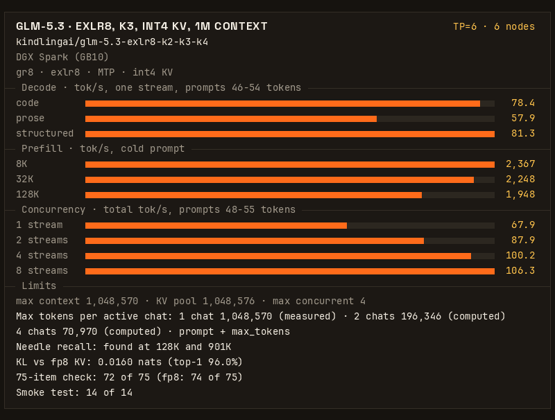

# KindlingAI: GLM-5.3 EXLR8 on six DGX Sparks (K3, 1M context)

If you are an agent booting this for someone, read [AGENTS.md](AGENTS.md) first, then the Quickstart.

_**Join our discord to learn more about KindlingAI and `gr8`: https://discord.gg/8EAvYPV2rE**_

Full GLM-5.3 on six DGX Sparks (GB10, 128 GB each) at TP=6, served by [gr8](https://github.com/kindlingai/gr8) from
[kindlingai/glm-5.3-exlr8-k2-k3-k4](https://huggingface.co/kindlingai/glm-5.3-exlr8-k2-k3-k4), with the K3 settings:
a 1,048,576-token int4 KV pool (the full context of the model), and the first 131,072 tokens of each chat on every box so that agent prompts up to that
size stay fast. This recipe is the published gr8 image, pinned by digest, and one `.env` file. Nothing is compiled.



The K3 settings build on the TP=6 recipe
[knapcio/GLM-5.3-gr8-6x-DGX-Spark-TP6](https://github.com/knapcio/GLM-5.3-gr8-6x-DGX-Spark-TP6). Thank you.

78.4 tok/s for one request writing code · 2,248 tok/s prefill on a 32K prompt · 4 requests at once, 100.2 tok/s in
total · a 1,048,576-token KV pool · a fact hidden in a 901K prompt found

## Results

Six DGX Sparks on one switch, TP=6, this recipe's `.env` (int4 KV, the default) under Docker Compose on the gr8 image
`sha-a555ee2` (one commit before the pinned v1.0; see [Engine pin](#engine-pin)), measured 2026-11-12 with gr8's own benchmark (`bench/bench.py`, default level), one boot.
GPU clocks were uncapped on all six boxes in the timed stages. Every speed is in tokens per second (tok/s).

One request, short prompts (46-54 tokens, up to 512 tokens out, 6 runs each):

| work | code | prose | structured | counting |
|---|---|---|---|---|
| tok/s, mean | 78.4 | 57.9 | 81.3 | 85.1 |
| 95% interval | 76.7 - 80.9 | 57.3 - 58.6 | 79.1 - 83.7 | 84.8 - 85.5 |

Prefill, cold prompt (one run each):

| prompt | first token | prefill tok/s | decode after it | first token, same prompt again (cached) |
|---|---|---|---|---|
| 8K tokens | 3.5 s | 2,367 | 55.2 tok/s | 0.08 s |
| 32K tokens | 14.6 s | 2,248 | 52.2 tok/s | 0.15 s |
| 128K tokens | 67.4 s | 1,948 | 37.3 tok/s | 0.39 s |

Requests at once (short mixed prompts, 48-55 tokens, up to 512 tokens out each):

| requests at once | 1 | 2 | 4 | 8 |
|---|---|---|---|---|
| total tok/s | 67.9 | 87.9 | 100.2 | 106.3 |
| tok/s per request | 69.1 | 55.4 | 34.3 | 36.4 |
| first token, median | 0.39 s | 0.93 s | 1.53 s | 12.2 s |

Four chats decode at once (`SESS=4`). With eight requests, four wait for a slot: that is the 12.2 s first token.

Checks on the same boot:

| check | result |
|---|---|
| smoke test | 14 of 14 |
| fact hidden in a 130,954-token prompt | found |
| fact hidden in a 901,428-token prompt (a separate request on the same boot) | found; first token after 920 s |
| count to 200, three times | 3 of 3 clean |
| KL against the fp8 KV format, 4,096 positions | mean 0.0160, top-1 agreement 96.0% |
| 75-item quality check (code, math, prose) | 72 of 75; the fp8 KV format scored 74 of 75 on the same boxes that night |
| longest context (`max_model_len`) | 1,048,570 tokens |
| boot to `/health` 200 | 98 s (one boot, model already on disk) |
| lowest `MemAvailable` recorded on any box, 901K prompt included | 5.00 GiB |

### How long each chat can be

The boot log line `# s2: ... pool of N pages` gives the real KV pool of each box:

    pages per box = R/64 + (CAP - R)/(64 x 6)        R = SHARE_LIMIT

The first R tokens of each chat are stored on every box; the rest is spread over the six boxes. With this recipe
(`CAP=1048576`, `SHARE_LIMIT=131072`) each box has 4,437 pages of 64 tokens. A chat of S tokens (prompt plus
`max_tokens`) holds S/64 pages a box up to R, and (S - R)/384 pages a box past R. Chats that are active together must
fit the pool:

| active chats | 1 | 2 | 4 |
|---|---:|---:|---:|
| tokens per chat, equal split | 1,048,570 | 196,346 | 70,970 |

The 1-chat value is the served `max_model_len`, which is the full context of GLM-5.3; the longest prompt that was run
is 901,428 tokens. The 2-chat and 4-chat values are computed from the pool size, not measured. One 245K chat holds
2,345 of the 4,437 pages, so a second one does not fit (computed; measured in October with the 3,303-page fp8 pool,
below). `SESS=4`: a fifth chat waits.

Why int4 KV gives so much more context here: with `SHARE_LIMIT=131072` the first 2,048 pages of the pool on each box
hold chat prefixes that are on every box, so with fp8 KV 3,303 pages a box (12.66 GB) gave only 612,992 tokens. int4
KV stores the attention latent in 4 bits: a row is 416 bytes, against 656 with fp8. 4,437 pages a box then use
11.26 GB (12.67 GB with the MTP pool, 1.0 GB less than fp8 used), and every page past the first 2,048 adds 384 tokens
of context.

### fp8 KV (the rollback)

`.env.example` has four commented lines (`KV_FORMAT=fp8`, `KV4_FOLD=0`, `KV4_TC=0`, `CAP=612992`) that give the
earlier KV format. Measured 2026-11-11 on the same image and boxes, one boot, the same benchmark, with this repo's `compose.yaml`:

| measure | fp8 KV |
|---|---|
| one request: code / prose / structured / counting | 78.4 / 58.2 / 81.5 / 85.2 tok/s |
| prefill, cold 8K / 32K / 128K | 2,173 / 2,241 / 1,990 tok/s |
| 1 / 2 / 4 / 8 requests at once, total | 67.5 / 86.0 / 97.6 / 105.6 tok/s |
| longest context (`max_model_len`) | 612,986 tokens |
| tokens per chat with 1 / 2 / 4 active chats | 612,986 / 105,658 / 52,794 (2 and 4 computed from 3,303 pages a box) |
| boot to `/health` 200 | 95 s |
| lowest `MemAvailable` recorded on any box | 6.89 GiB |

### Earlier measurements (October 2026): long prompts

K3 was first measured in October 2026 on a pre-release TP=6 build of gr8 (gr8 plus the 39 patches of the knapcio
recipe), on bare metal, booting converted model files, with the GPU clock capped at 2000 MHz. These rows have no match
in the benchmark above:

| measure | value |
|---|---|
| two prompts of about 100K sent at once | 201,676 tokens in 128 s (1,575 tok/s); a resend read 98,304 tokens from the cache, first token 1.7-3.0 s |
| 245K cold prefill | 188-190 s (about 1,290 tok/s); a fact hidden in the prompt was found |
| 245K next turn (same prefix and one new line) | first token 4.5 s; 241,664 of 244,649 tokens from the prefix cache |
| decode at 245K context | 29.0 tok/s |
| two 245K agents at once | the second evicts the first: both prefill again (first token 188 s and 393 s) |
| a 50K cached turn sent during a 245K cold prefill | first token 9.0 s |

### Why SHARE_LIMIT is 131072

Measured in October 2026 on the pre-release build:

| `SHARE_LIMIT` / `CAP` | pages a box | pool GB a box | result |
|---|---|---|---|
| 131072 / 612992 (this recipe with fp8 KV) | 3,303 | 12.66 | serves; lowest `MemAvailable` 5.14 GiB; one 245K chat resident at a time |
| 262144 / 540672 | 4,821 | 17.90 | out of memory at boot |
| 49152 / 761728 | 2,623 | 10.32 | serves (`max_model_len` 761,722) and two 245K chats stay cached, but a 50K turn waited over 250 s behind a 245K cold prefill, and `MemAvailable` fell to 3.90 GiB |

A larger R does not fit in memory. A smaller R puts agent prompts of 50K to 130K past R, where they wait behind long
prefills: with R at 65,536 and the same `CAP`, agents with 80-130K prompts saw the first token go from 12-16 s to
57-90 s.

[kindling.json](kindling.json) has the card's numbers in a form a program can read.

## Quickstart

On every box, first turn off proactive memory compaction and open TCP ports 7340 and 7341 between the boxes
([What you need](#what-you-need)). Then, on every box:

```bash
git clone https://github.com/kindlingai/glm-5.3-exlr8-6x-spark && cd glm-5.3-exlr8-6x-spark
cp .env.example .env
nano .env                  # PEERS: the six LAN addresses, head first. The same file on every box.
docker compose up -d       # pulls the pinned gr8 image; the first boot fetches this box's part of the model
docker compose logs -f     # this box's supervisor; ready when the cluster serves
```

Then, on the head (the first address in `PEERS`):

```bash
docker compose exec gr8 /opt/gr8/gr8 glm53 smoke
curl -s localhost:8100/v1/models      # max_model_len 1048570
```

The head serves an OpenAI-compatible API on port 8100. Stop the cluster with
`docker compose exec gr8 /opt/gr8/gr8 glm53 down` on the head, then `docker compose down` on every box.

A box that ran the earlier form of this recipe (its own image) has its part of the model in the docker volume
`glm53-6x-cache`. To use that volume again, set `GR8_CACHE` in `.env` to its directory
(`docker volume inspect glm53-6x-cache --format '{{.Mountpoint}}'`). The cache is keyed by Hugging Face commit: the box
reads what the volume holds at the commits pinned in `.env`, and fetches the rest.

## What you need

- Six DGX Sparks or other GB10 boxes (128 GB unified memory), with nothing else holding much memory. A box runs one
  model at a time.
- A RoCE v2 fabric between the ConnectX-7 ports through one 200G switch. Six boxes do not work as a ring.
- A LAN between the boxes with TCP ports 7340 and 7341 open.
- Docker with the NVIDIA container toolkit (DGX OS has both).
- About 90 GB of disk a box for the model.
- Proactive memory compaction off on every box:
  `sudo sysctl -w vm.compaction_proactiveness=0` (gr8's
  [DEPLOY.md](https://github.com/kindlingai/gr8/blob/main/docs/DEPLOY.md#before-you-start) has the permanent form).

## What K3 is

K3 is the TP=6 settings of the knapcio recipe (MTP=3 drafting with early stop, `KVB=bf16`), plus three changes:

- `PF_GEMMF32=1`: a faster prefill kernel with the same output, byte for byte.
- `GR8_K1_SPLIT=1:/4,2-3:2x1,4-32:8x1/4`: a different split of one decode kernel when several rows decode together.
- `KV_FORMAT=int4` with `KV4_FOLD=1`, `KV4_TC=1`, `CAP=1048576`, and five `GR8_KV4_*` settings in `EXTRA_ENV` for the
  int4 attention kernels: the KV pool goes from 612,992 to 1,048,576 tokens.

Every line is in [.env.example](.env.example). gr8's
[SETTINGS.md](https://github.com/kindlingai/gr8/blob/main/docs/SETTINGS.md) explains each setting.

## Help

Ask on Discord (https://discord.gg/8EAvYPV2rE) or open an issue in this repo
(https://github.com/kindlingai/glm-5.3-exlr8-6x-spark/issues). Say which step failed, and include:

- the command you ran, and the end of `docker logs glm53-6x-spark`, before you remove the container;
- if it still runs, `docker exec glm53-6x-spark /opt/gr8/gr8 glm53 status`.

Remove addresses and hostnames before you post.

## Engine pin

This recipe has no engine code. It runs one published gr8 image, named by tag and digest in
[compose.yaml](compose.yaml) and in the `engine` field of [kindling.json](kindling.json):

| | |
|---|---|
| engine | [kindlingai/gr8](https://github.com/kindlingai/gr8) [`v1.0`](https://github.com/kindlingai/gr8/releases/tag/v1.0) at [`db6f2c1`](https://github.com/kindlingai/gr8/commit/db6f2c17c7b05303b69ce667e416d10340aeb9b7) |
| image | `ghcr.io/kindlingai/gr8:v1.0` |
| digest | `sha256:11ff2823184b0512ae62e0f1c281c46941cfb0fd81096e1dac4c313ad3fe9413` |

The results above were measured on the image of gr8 commit [`a555ee2`](https://github.com/kindlingai/gr8/commit/a555ee2a078946332769b5cd412ba3c73c46e242) (`ghcr.io/kindlingai/gr8:sha-a555ee2`). v1.0 is one commit after it, and that commit changes only the README, the docs, the benchmark tools and their result files, not the engine source. This recipe was not booted again on the v1.0 image.

After v1.0, the pin moves to a newer gr8 release only after this recipe was booted and measured on it. `python3 check.py` checks
that `compose.yaml` and `kindling.json` name the same image; CI runs it on every pull request.

For six boxes with gr8's own defaults (614,400-token pool, eight chats), use
[glm-5.3-exlr8-4x-spark](https://github.com/kindlingai/glm-5.3-exlr8-4x-spark) with six addresses in `PEERS`.
For five boxes, see [glm-5.3-exlr8-5x-spark](https://github.com/kindlingai/glm-5.3-exlr8-5x-spark).

## License

MIT, see [LICENSE](LICENSE). GLM-5.3 has its own licence: see the
[model page](https://huggingface.co/kindlingai/glm-5.3-exlr8-k2-k3-k4).
